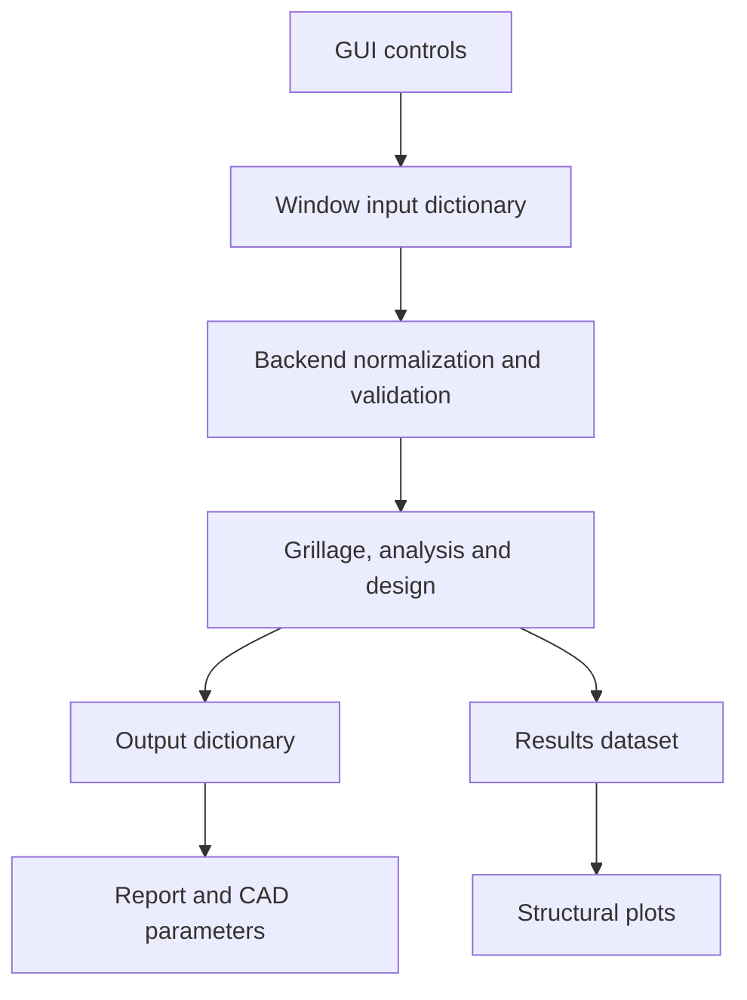

# OsdagBridge source map

Source reviewed on upstream `dev` at `de8c692b9d346a2c7bc12255c3a3d498bbf4b3b5`. Paths below are relative to `src/osdagbridge`. This is a static trace.

| Functionality | Source file | Function or class | Purpose |
| --- | --- | --- | --- |
| GUI inputs | `desktop/ui/docks/input_dock.py` | `InputDock._update_input_dict` | Writes changed widget values into the parent input dictionary. Empty values fall back to basic defaults. |
| Input Dictionary | `desktop/ui/template_page.py` | `CustomWindow.common_design_func` | Validates required GUI inputs, extends layout defaults, syncs computed and refreshed values, and passes the dictionary to the worker. |
| Backend input | `core/bridge_types/plate_girder/plategirderbridge.py` | `PlateGirderBridge.set_input`, `_normalize_input_dict` | Normalizes values and stores the full dictionary plus basic and additional subsets. |
| Engineering calculations | Same backend file | `design`, `_validate_inputs`, `_stage_grillage_setup`, `_run_dcr_checks`, `design_deck_slab` | Coordinates validation, grillage and loading, analysis and member checks. |
| Output Dictionary | Same backend file | `_solve_bridge_layout`, `store_design_results`, `design_deck_slab`, `design` | Copies inputs into the output dictionary, adds design results and freezes the completed mapping. |
| Design report | Same backend file | `generate_design_report` | Copies the output dictionary into the report data. |
| CAD | `desktop/ui/cad_3d.py` | `CAD3DWindow.render_3d_cad` | Renders geometry from the DTO returned by `PlateGirderBridge.get_3d_cad_parameters`. |
| Structural plots | `desktop/ui/mpl_plot_widget.py` | `MplPlotWidget.setup` | Loads the completed results dataset, load cases, nodes and members. |
| Unlock and rerun | `desktop/ui/docks/input_dock.py` | `InputDock.toggle_lock` | After confirmation, clears CAD, plots, output and logs, and calls the backend reset before allowing input edits. |
| Automated tests | `tests/unit/`, `tests/integration/` | Six placeholder functions | The checked-in tests contain placeholders. Passing them would give no evidence of design or GUI behaviour. |

## Span trace

`KEY_SPAN` is defined as `geometry.span` in `core/utils/common.py`. The input dock writes the GUI value into `CustomWindow.input_dict`. The design worker passes that dictionary to `set_input`, then runs `design`. The backend validates that the span is positive, copies it to `output_dict`, and converts that output span from metres to millimetres when building the 3D CAD DTO. The CAD check can therefore compare a GUI input in metres against a DTO value in millimetres. That comparison still needs a completed run.

For test evidence, capture the input at the worker handoff. The existing input dictionary print in `common_design_func` comes before the final computed and refreshed field syncs.
